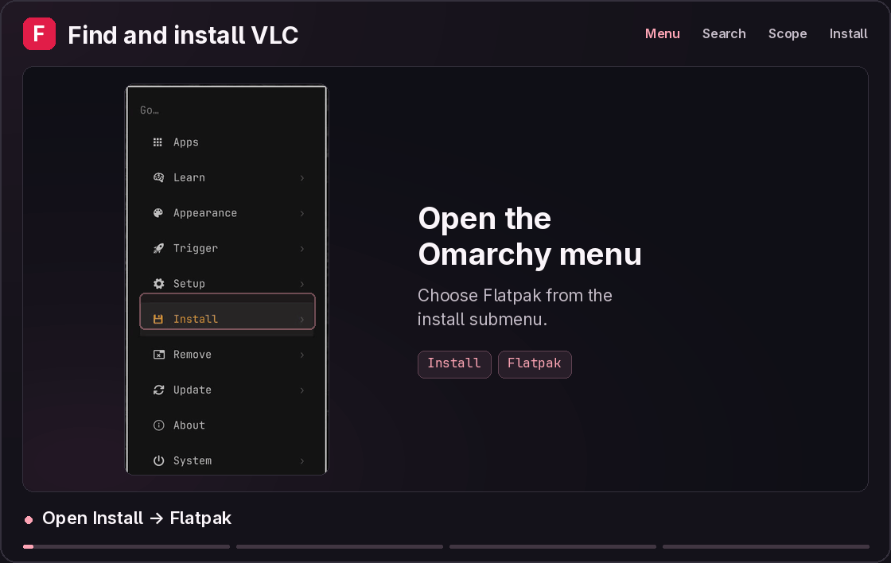
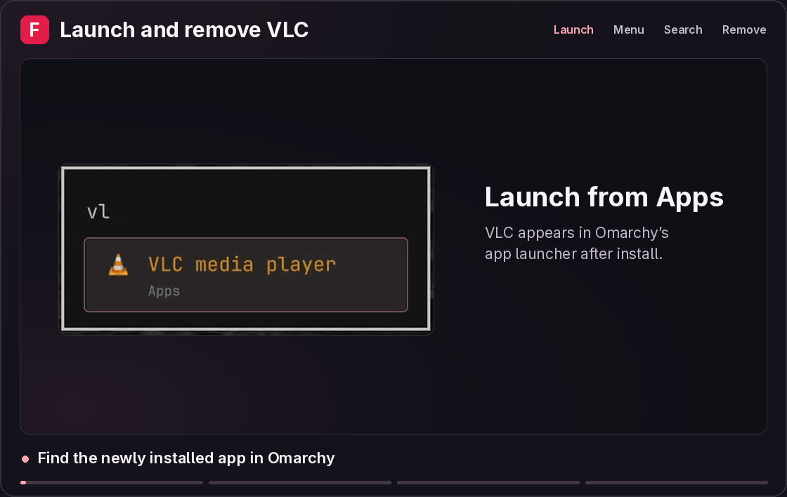

<p align="center">
  
</p>

<h1 align="center">Flatfind</h1>

<p align="center">
  Find, install, and remove Flatpak apps right from the Omarchy menu.
</p>

<p align="center">
  <a href="#quick-start">Quick start</a> ·
  <a href="#demo">Demo</a> ·
  <a href="#picker-controls">Picker controls</a> ·
  <a href="#terminal-usage">Terminal usage</a>
</p>

## Quick start

Flatfind requires **Omarchy 4.5+**, **Flatpak**, **Python 3**, and **fzf 0.64+**. Install any missing dependencies, then add and enable the plugin from your Omarchy session.

```sh
omarchy pkg add flatpak python fzf
omarchy plugin add https://github.com/wfoyt/flatfind.git --enable
```

Flatfind searches your configured Flatpak remotes. Run `flatpak remotes` to check which sources are available.

If you already have a local checkout, run `./install` from the project directory to install that copy.

## Demo

### Find and install VLC

Open **Install → Flatpak** in the Omarchy menu. Search by app name or ID, then check **Details** for the source, branch, architecture, and any available version and description.



Press **Enter** to review your selections. If an app is available from Flathub in both the user and system installations, choose where to install it. Flatpak lists the apps, dependencies, source, and requested permissions before asking you to confirm. Answer **n** to cancel a transaction.

### Launch and remove VLC

Installed apps appear in the Omarchy **Apps** menu. Flatfind keeps the menu in sync when you install or remove apps through the picker or directly with the Flatpak CLI.



Open **Remove → Flatpak** to search installed apps. Press **Enter** to remove the highlighted app or your batch selection, or **Esc** to close the picker before removing anything.

## Picker controls

| Key | Action |
| --- | --- |
| **↑** / **↓** | Move through results. |
| **Tab** | Toggle selection for a batch install or removal. |
| **Alt+P** | Show or hide the details pane. |
| **Alt+J** / **Alt+K** | Scroll the details pane down or up. |
| **Enter** | Review the install or start removal. |
| **Esc** | Close the picker. |

<details>
  <summary>See batch selection</summary>

  
</details>

Flatpak asks for confirmation separately for each remote and installation scope in an install batch.

## Terminal usage

From a local checkout, pass a search term to open the picker with matching results.

```sh
./flatfind vlc
./flatfind remove vlc
```

Use `--user`, `--system`, or `--installation NAME` to limit either picker to a specific installation. For installs, `--refresh` refreshes remote catalogs and `--runtimes` includes runtimes in the search.

## Uninstall the plugin

Disable Flatfind, clean up its menu entries, launcher links, and login integration, then remove the plugin.

```sh
omarchy plugin disable wfo.flatfind &&
  python3 "$HOME/.config/omarchy/plugins/wfo.flatfind/omarchy/desktop.py" --cleanup &&
  omarchy plugin remove wfo.flatfind
```
