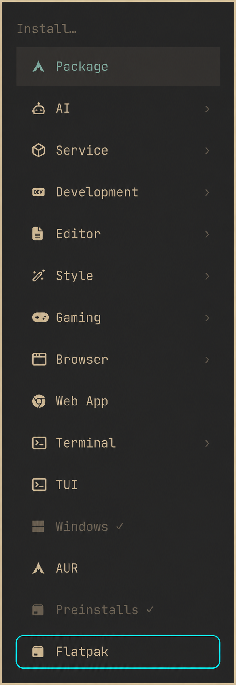
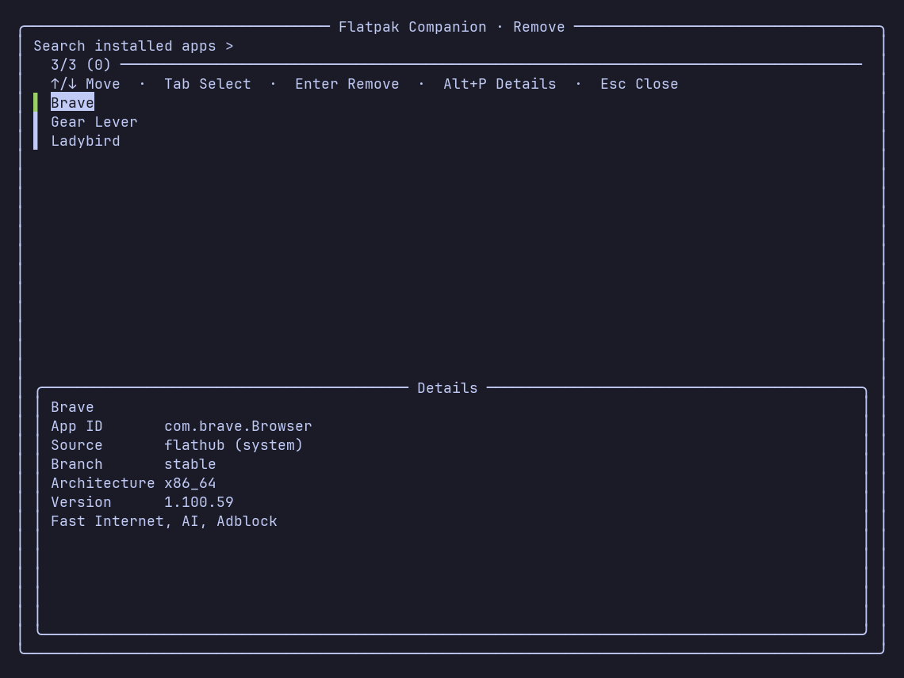

<p align="center">
  
</p>

<h1 align="center">Flatpak Companion</h1>

<p align="center">
  Find, install, and remove Flatpak apps right from the Omarchy menu.
</p>

<p align="center">
  <a href="#quick-setup">Quick setup</a> ·
  <a href="#omarchy-menu-integration">Omarchy menu</a> ·
  <a href="#demo">Demo</a> ·
  <a href="#picker-controls">Picker controls</a> ·
  <a href="#terminal-usage">Terminal usage</a>
</p>

## Features

- Search configured Flatpak remotes by application name or ID, and inspect the source, branch, architecture, version, and description in the details pane.
- Select multiple applications for installation or removal, and review each Flatpak transaction before confirming it.
- Choose between user and system installations when an app is available in both Flathub scopes. Target a named system installation from the command line.
- Browse installed apps and remove them from the same keyboard-driven picker.
- Optionally add Flatpak entries to Omarchy's Install and Remove menus and keep Flatpak launchers visible in the Apps menu.
- Refresh remote catalogs, include runtimes, or start a picker with a search term from the terminal.

## Quick Setup

Install **Flatpak**, **Python 3**, and **fzf 0.64+** on Omarchy 4.5+, then install the CLI. Omarchy fetches the plugin and its service creates the command in `~/.local/bin`. Flatpak Companion uses the Omarchy-provided `jq`, `xdg-terminal-exec`, and systemd user manager. The project is licensed under MIT.

```sh
omarchy pkg add flatpak python fzf
omarchy plugin add https://github.com/wfoyt/flatpak-companion.git --enable
```

Run `flatpak-companion` to find apps, or `flatpak-companion remove` to browse installed apps. If your shell cannot find the command, use `~/.local/bin/flatpak-companion`. From a local checkout, `./install` also installs the CLI. CLI installation registers a systemd user path unit that cleans up the plugin’s files when Omarchy removes it.

To add **Install → Flatpak** and **Remove → Flatpak** to the Omarchy menu, run:

```sh
flatpak-companion setup
```

Setup shows the menu file and login script link, explains launcher syncing, and asks for confirmation (default **No**). After confirmation it merges the menu rows, preserves custom rows, and enables a watcher that keeps Flatpak apps visible in the Apps menu. The UWSM link makes Flatpak exports visible at future logins. Disabling the plugin stops the watcher.

Flatpak Companion searches your configured Flatpak remotes. Run `flatpak remotes` to check which sources are available. When Flathub is configured, opening the install picker can use `curl` to fetch display names and descriptions from `dl.flathub.org`. It caches them for 24 hours under `$XDG_CACHE_HOME/flatpak-companion` (by default `~/.cache/flatpak-companion`).

## Omarchy menu integration

After running `flatpak-companion setup` and confirming the changes, open the Omarchy menu and choose **Install → Flatpak** to search for applications. Choose **Remove → Flatpak** to browse installed apps. Both entries open the picker in a terminal.



The enabled service watches Flatpak desktop exports, including changes made with the Flatpak CLI. It adds fallback launcher links when needed so applications can appear under **Apps**. Setup also links a UWSM environment script for future logins. Existing menu entries are preserved, including custom entries that use the same IDs.

Use `omarchy plugin disable wfoyt.flatpak-companion` to stop the watcher and hide the menu entries. Enable it again with `omarchy plugin enable wfoyt.flatpak-companion`. Use **Remove → Flatpak** to uninstall an app. Deleting a fallback launcher from **Apps** hides that fallback while the app remains installed.

## Demo

### Find and review a VLC install

Open **Install → Flatpak** in the Omarchy menu. Search by app name or ID, then check **Details** for the source, branch, architecture, and any available version and description.


Press **Enter** to review your selections. If an app is available from Flathub in both the user and system installations, choose where to install it. Flatpak lists the apps, dependencies, source, and requested permissions before asking you to confirm. Answer **n** to cancel a transaction.

### Launch and remove apps

Installed apps appear in the Omarchy **Apps** menu. Flatpak Companion keeps the menu in sync when you install or remove apps through the picker or directly with the Flatpak CLI.



Open **Remove → Flatpak** to search installed apps. Press **Enter** to review the highlighted app or batch selection. Flatpak asks for confirmation for each installation. Answer **n** to cancel that transaction.

## Picker controls

| Key | Action |
| --- | --- |
| **↑** / **↓** | Move through results. |
| **Tab** | Toggle selection for a batch install or removal. |
| **Alt+P** | Show or hide the details pane. |
| **Alt+J** / **Alt+K** | Scroll the details pane down or up. |
| **Enter** | Review the install or removal. |
| **Esc** | Close the picker. |

<details>
  <summary>See batch selection</summary>

  
</details>

Flatpak asks for confirmation separately for each remote and installation scope in an install batch. Picker prompts follow **Setup → Language** the next time the picker opens. Flatpak Companion ships English and Danish, with English as the fallback.

## Terminal usage

Pass a search term to open the picker with matching results. The install picker searches both user and default system remotes by default, while the removal picker lists installed applications across installations.

```sh
flatpak-companion vlc
flatpak-companion remove vlc
```

Limit either picker to an installation with `--user`, `--system`, or `--installation NAME`. For example:

```sh
flatpak-companion --user vlc
flatpak-companion remove --system vlc
flatpak-companion --installation NAME
```

For installation searches, `--refresh` asks Flatpak to refresh remote catalogs and `--runtimes` includes runtimes alongside apps.

```sh
flatpak-companion --refresh
flatpak-companion --runtimes
```

Run `flatpak-companion --help`, `flatpak-companion remove --help`, or `flatpak-companion setup --help` for the available options. From a local checkout, use `./flatpak-companion` in place of the installed command.

## Uninstall the plugin

Remove Flatpak Companion through **Setup → Plugins → Remove**, or run:

```sh
omarchy plugin remove wfoyt.flatpak-companion
```

The cleanup unit removes the CLI link, plugin-owned menu rows, fallback launcher links, and UWSM drop-in. Installed Flatpak apps and custom menu entries are preserved.
