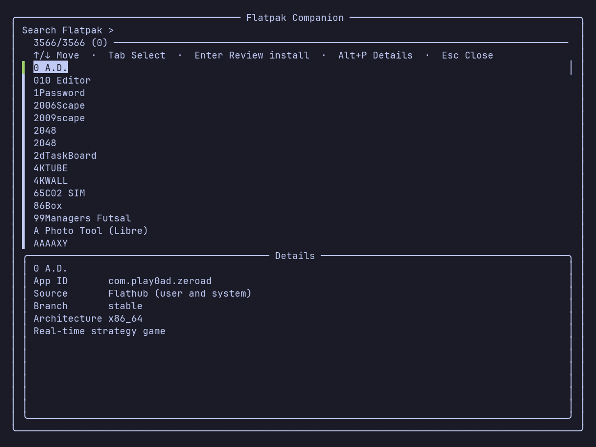

<p align="center">
  
</p>

<h1 align="center">Flatpak Companion</h1>

<p align="center">
  Find, install, and remove Flatpak apps right from the Omarchy menu.
</p>

<p align="center">
  <a href="#quick-setup">Quick setup</a> ·
  <a href="#demo">Demo</a> ·
  <a href="#picker-controls">Picker controls</a> ·
  <a href="#terminal-usage">Terminal usage</a>
</p>

## Quick Setup

Install **Flatpak**, **Python 3**, and **fzf 0.64+** on Omarchy 4.5+, then install the CLI. Omarchy fetches the plugin and its service creates the command in `~/.local/bin`.

```sh
omarchy pkg add flatpak python fzf
omarchy plugin add https://github.com/wfoyt/flatpak-companion.git --enable
```

Run `flatpak-companion` to find apps, or `flatpak-companion remove` to browse installed apps. If your shell cannot find the command, use `~/.local/bin/flatpak-companion`. From a local checkout, `./install` also installs the CLI.

To add **Install → Flatpak** and **Remove → Flatpak** to the Omarchy menu, run:

```sh
flatpak-companion setup
```

Setup shows the menu file and login script link, explains launcher syncing, and asks for confirmation (default **No**). After confirmation it merges the menu rows, preserves custom rows, and enables a watcher that keeps Flatpak apps visible in the Apps menu. The UWSM link makes Flatpak exports visible at future logins. Disabling the plugin stops the watcher.

Flatpak Companion searches your configured Flatpak remotes. Run `flatpak remotes` to check which sources are available. When Flathub is configured, opening the install picker also uses curl to fetch display names and descriptions from `dl.flathub.org`. It caches them for 24 hours under `$XDG_CACHE_HOME/flatfind` (by default `~/.cache/flatfind`).

For an existing Git installation, run `omarchy plugin update wfo.flatfind` and then run setup once to opt in to launcher syncing. Existing menu entries and login links are preserved. To use only the CLI after upgrading, disable the plugin, run the cleanup command in **Uninstall the plugin**, then run `~/.config/omarchy/plugins/wfo.flatfind/install` to restore the CLI link.

## Demo

### Find and review a VLC install

Open **Install → Flatpak** in the Omarchy menu. Search by app name or ID, then check **Details** for the source, branch, architecture, and any available version and description.



Press **Enter** to review your selections. If an app is available from Flathub in both the user and system installations, choose where to install it. Flatpak lists the apps, dependencies, source, and requested permissions before asking you to confirm. Answer **n** to cancel a transaction.

### Launch and remove apps

Installed apps appear in the Omarchy **Apps** menu. Flatpak Companion keeps the menu in sync when you install or remove apps through the picker or directly with the Flatpak CLI.


Open **Remove → Flatpak** to search installed apps. Press **Enter** to review the highlighted app or batch selection. Flatpak asks for confirmation for each installation. Answer **n** to cancel that transaction.

## Picker controls

| Key | Action |
| --- | --- |
| **↑** / **↓** | Move through results. |
| **Tab** | Toggle selection for a batch install or removal. |
| **Alt+P** | Show or hide the details pane. |
| **Alt+J** / **Alt+K** | Scroll the details pane down or up. |
| **Enter** | Review the install or removal. |
| **Esc** | Close the picker. |

<details>
  <summary>See batch selection</summary>

  
</details>

Flatpak asks for confirmation separately for each remote and installation scope in an install batch.

## Terminal usage

From a local checkout, pass a search term to open the picker with matching results.

```sh
./flatpak-companion vlc
./flatpak-companion remove vlc
```

Use `--user`, `--system`, or `--installation NAME` to limit either picker to a specific installation. For installs, `--refresh` refreshes remote catalogs and `--runtimes` includes runtimes in the search.

## Uninstall the plugin

Disable Flatpak Companion, clean up its CLI link, menu entries, launcher links, and login integration, then remove the plugin.

```sh
omarchy plugin disable wfo.flatfind &&
  python3 "$HOME/.config/omarchy/plugins/wfo.flatfind/omarchy/desktop.py" --cleanup &&
  omarchy plugin remove wfo.flatfind
```
