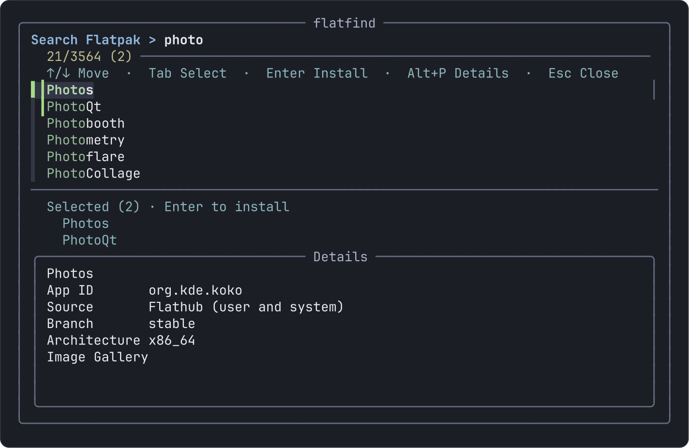
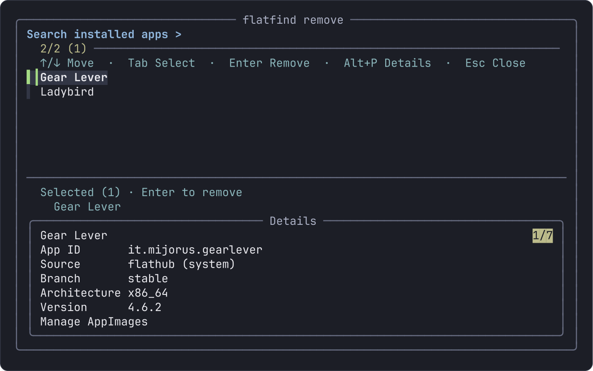

# flatfind

**Find, install, and remove Flatpak apps from your terminal.**

flatfind is a full-screen picker inspired by Omarchy. Search by app name or ID, preview package details, and select multiple apps in one session.



## Install

Install **Flatpak**, **Python 3**, and **fzf 0.64 or later** and make sure they’re on your `PATH`. To browse apps, enable a Flatpak remote such as Flathub.

```sh
git clone https://github.com/wfoyt/flatfind.git
cd flatfind
install -Dm755 flatfind ~/.local/bin/flatfind
```

Make sure `~/.local/bin` is on your `PATH`.

## Browse and manage apps

```sh
flatfind           # Browse apps available to install
flatfind photo     # Open with “photo” in the search field
flatfind remove    # Browse installed apps
```

Both pickers accept an optional search term, so you can also run `flatfind remove "Gear Lever"`. Flatpak asks for confirmation before installing or removing apps.



## Keyboard controls

| Key | Action |
| --- | --- |
| **↑ / ↓** | Move through the results. |
| **Tab** | Mark or unmark the highlighted app. Marked apps appear in the footer. |
| **Enter** | Continue with the marked apps, or the highlighted app if none are marked. |
| **Alt+P** | Show or hide the details pane. |
| **Esc** | Close the picker and return to your shell. |

The details pane shows the highlighted app’s ID, source, installation, branch, and architecture, plus its version and summary when available.

## Installations and catalogs

By default, `flatfind` searches enabled remotes in the user and default system installations. Matching Flathub entries with the same app ID, branch, and architecture appear once. When an app is available in both installations, press **Enter** and choose **User** or **System**. The removal picker lists each installed copy separately.

| Command | What it does |
| --- | --- |
| `flatfind --user` | Browse apps available to your user installation. |
| `flatfind --system` | Browse apps available to the default system installation. |
| `flatfind --installation work` | Browse a named system installation. |
| `flatfind --runtimes` | Include runtimes in the results. |
| `flatfind --refresh` | Refresh remote catalogs and Flathub display metadata. |
| `flatfind remove --user` | Browse only apps installed for your user. |

Search runs locally with `fzf`. flatfind caches display names and summaries from Flathub’s AppStream catalog for one day. Run `flatfind --help` or `flatfind remove --help` for all available options.
